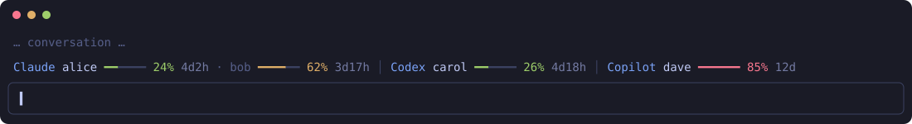

# omp-account-usage

See how much of every AI subscription you have left, for every account, without leaving [oh-my-pi (omp)](https://github.com/can1357/oh-my-pi).



omp's built-in `usage` status-line segment shows only the account behind the current model. If you juggle two Claude Max accounts, a ChatGPT plan for Codex, and Copilot at work, you have to run `/usage` to see the rest. This extension keeps all of them on one line above the editor.

## Install

```sh
omp plugin install github:minigold92/omp-account-usage
```

Then restart omp. The line appears as soon as omp has usage data for at least one signed-in account.

```sh
omp plugin upgrade omp-account-usage     # update
omp plugin uninstall omp-account-usage   # remove
omp -e /path/to/account-usage.ts         # try a local copy without installing
```

Already copied `account-usage.ts` into `~/.omp/agent/extensions/`? Delete that copy first; two copies draw the same widget and overwrite each other.

## Reading the line

Each account reads as `alice ━━━━━━ 24% 4d2h`:

| Part | Example | Meaning |
| --- | --- | --- |
| Provider | `Claude` | starts each group; groups are separated by `│` |
| Account | `alice` | accounts of the same provider are separated by `·` |
| Gauge | `━━━━━━` | filled share in the usage color |
| Percent | `24%` | used share of the limit |
| Reset | `4d2h` | time until the limit window resets |

- **Provider groups** keep a fixed order: Claude, Codex, Copilot, Cursor, Gemini, …, then other providers by id.
- **The account this session is using comes first** in its group in normal text; the provider's other accounts are dimmed.
- **Colors:** green below 50%, yellow below 80%, red from 80% (over 100% means overage).
- **Account names** are the part of your login email before `@`; if two accounts share it, the full email; if that still matches (team seats), a short org id is added.
- **Rolling windows** that refill step by step (Synthetic, Umans) show `regen 3h` or `tick 20m` instead of a plain reset time.
- **Narrow terminals:** one line per provider, then shorter gauges, then the line is cut with `…`.

## Which limit it shows

Every provider has several limits (5-hour, weekly, monthly, per model, …). The widget shows one per account:

1. the **weekly** window, if the account has one;
2. otherwise the **longest** window (monthly, billing period, …), then shorter ones;
3. among limits on the same window, the **most used** one.

Per-model and per-tier meters (Claude Opus, Codex Spark, Copilot per model) count only when an account has nothing else. Run `/usage` in omp to see every limit.

## Supported providers

omp fetches usage from each provider and converts it into one common format; this extension only reads that. Any provider omp reports a percentage-style limit for shows up, including ones added in future omp releases (they appear under their omp provider id).

| Shown as | omp provider id | Checked with a live account |
| --- | --- | --- |
| Claude | `anthropic` | ✅ |
| Codex | `openai-codex` | ✅ |
| Copilot | `github-copilot` | not yet |
| Cursor | `cursor` | not yet |
| Gemini | `google-gemini-cli` | not yet |
| Antigravity | `google-antigravity` | not yet |
| Grok | `xai-oauth` | not yet |
| Kimi | `kimi-code` | not yet |
| Z.ai | `zai` | not yet |
| MiniMax | `minimax-code` | not yet |
| Alibaba | `alibaba-token-plan` | not yet |
| OpenCode Go | `opencode-go` | not yet |
| Droid | `factory-droid` | not yet |
| Devin | `devin` | not yet |
| Synthetic | `synthetic` | not yet |
| Umans | `umans` | not yet |

Live checks: omp 19.0.1 with two Claude accounts and one Codex account. The other providers have not been run against a live account; the report shapes they send (monthly and `1w` windows, Kimi's monthly ids, tier-only quotas, regen/tick countdowns) are covered by unit tests with hand-made reports modelled on omp's usage reporters.

Not shown: accounts whose plan has no percentage-style limit, such as balance-only plans (Charm Hyper) or local Ollama, which reports no limits.

**Something looks wrong for your provider?** Please [open an issue](https://github.com/minigold92/omp-account-usage/issues) with your omp version (`omp --version`) and the matching part of `/usage` (mask your email).

## Troubleshooting

| Symptom | Cause / fix |
| --- | --- |
| Nothing above the editor | omp has no usage data yet. Run `/usage`; if it shows nothing either, sign in with `/login`. The widget also stays hidden in non-interactive runs (`omp -p`). |
| Warning: "this omp build has no AuthStorage usage API" | Your omp version does not expose the internal API this extension reads. Update omp or open an issue with your version. |
| The line flickers between two versions | Two copies are loaded. Remove the one in `~/.omp/agent/extensions/` or the extra `-e`. |
| A provider is missing | It has no percentage-style limit, or omp does not report usage for it. Check `/usage`. |

## How it works

- Reads omp's own usage cache through `authStorage.usage` and `authStorage.oauth`. These are internal omp APIs, not part of the public extension typings, so a future omp release could change them; if they disappear, the widget turns itself off with one warning instead of erroring.
- Refreshes every 15 seconds and after every turn. omp caches provider usage for about 5 minutes and shares concurrent requests, so the refresh mostly reads that cache.
- Sends nothing anywhere and stores nothing. Account names come from your local omp login.

## Development

```sh
git clone https://github.com/minigold92/omp-account-usage
cd omp-account-usage
bun test
omp -e ./account-usage.ts   # try your changes (remove any installed copy first)
```

Everything lives in `account-usage.ts`; `account-usage.test.ts` covers window choice, account names, and rendering.

## License

[MIT](LICENSE). Includes code adapted from oh-my-pi (MIT); see [NOTICE](NOTICE).
